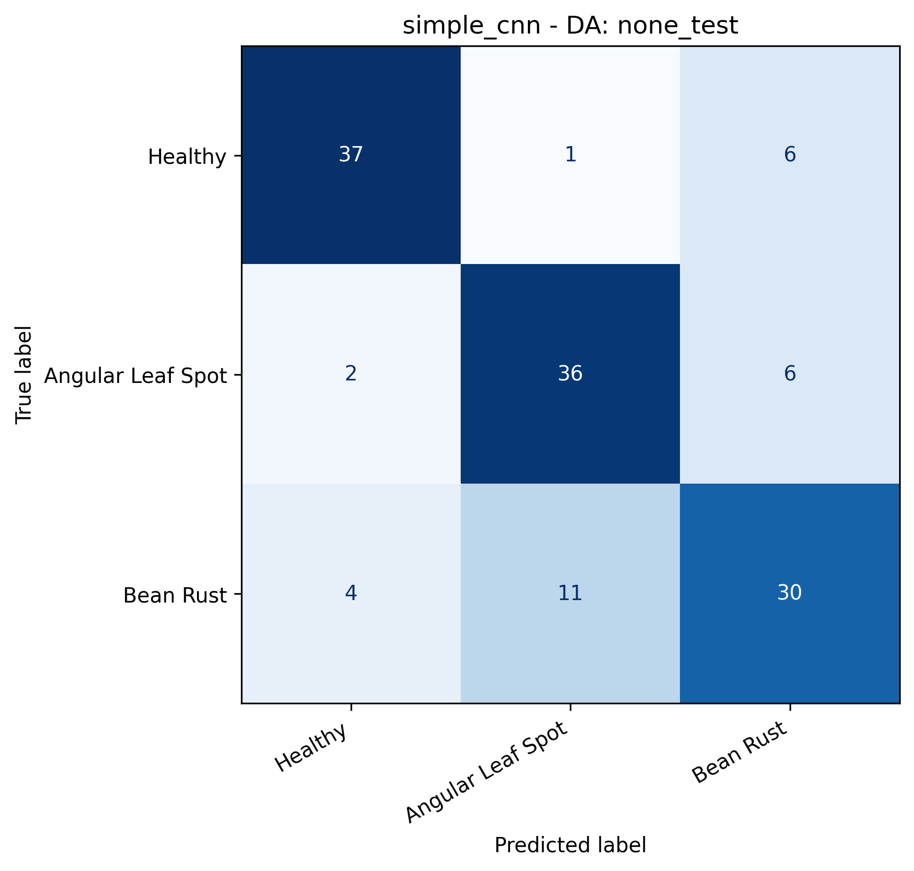
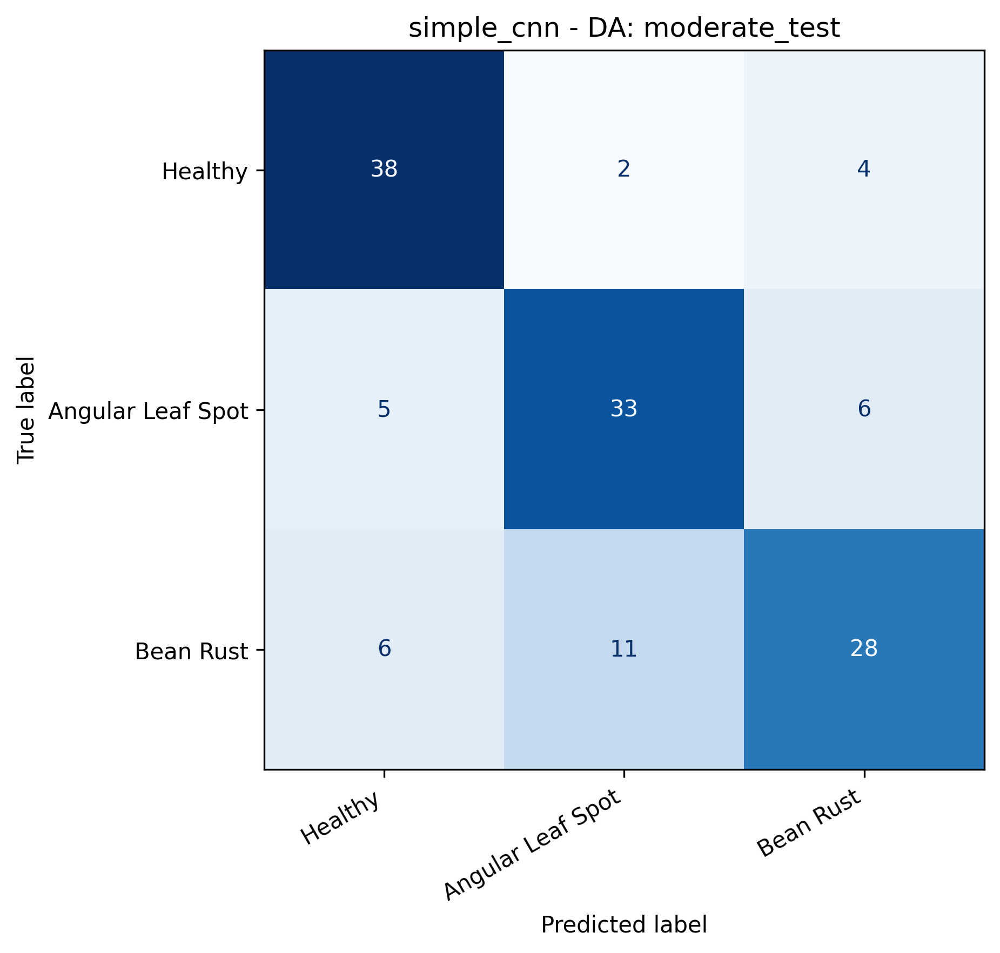
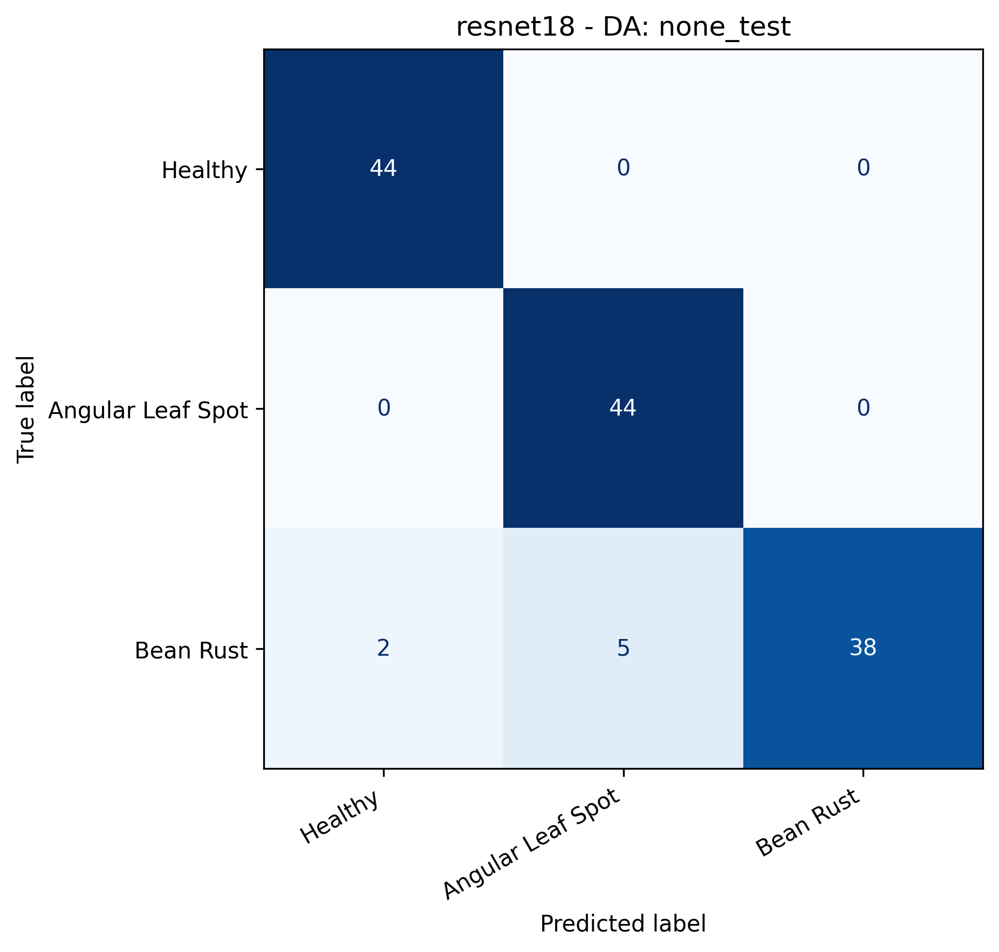
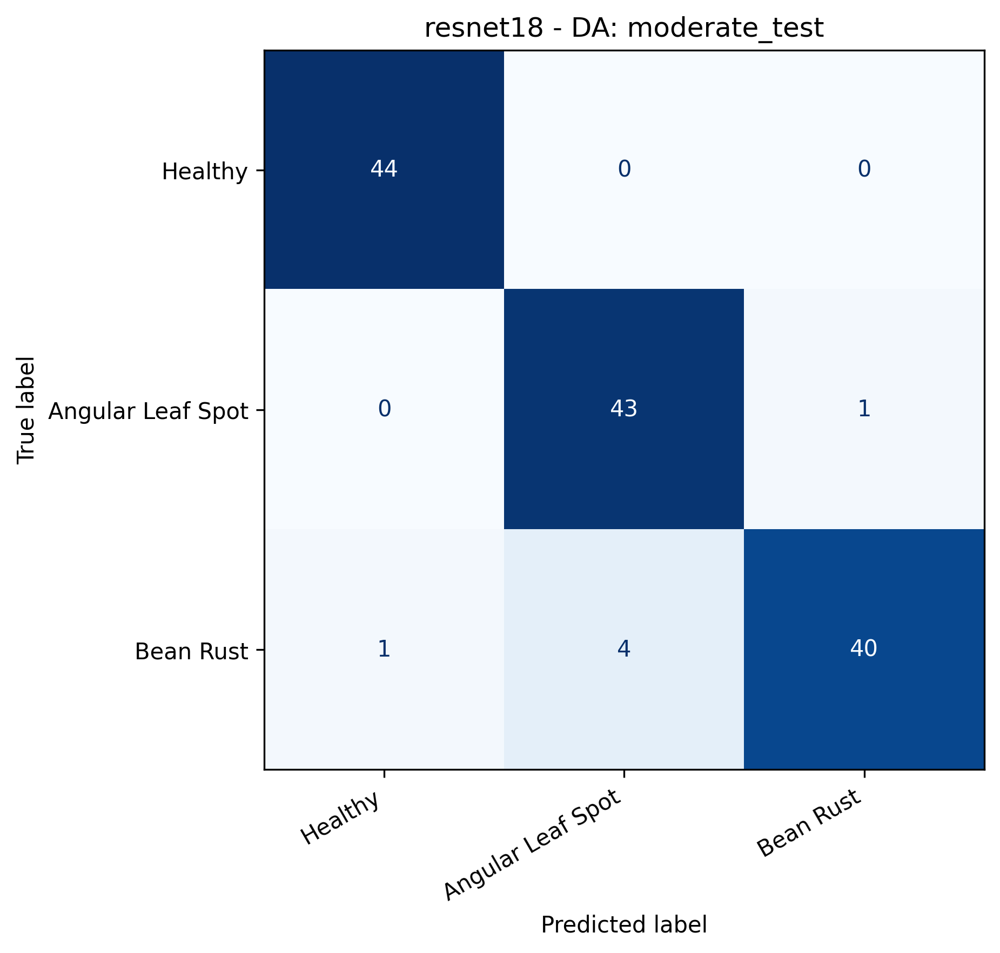
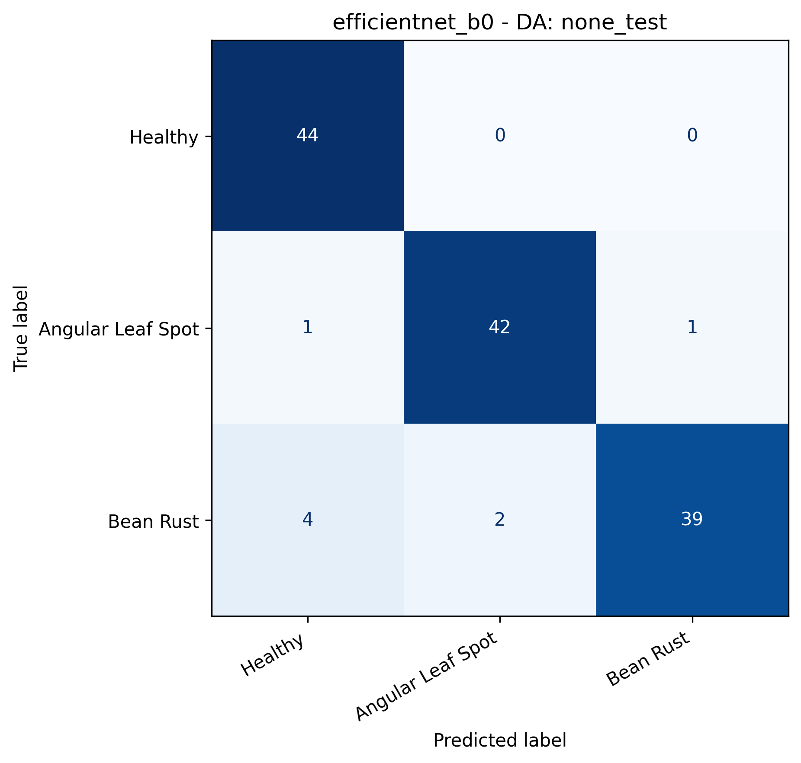
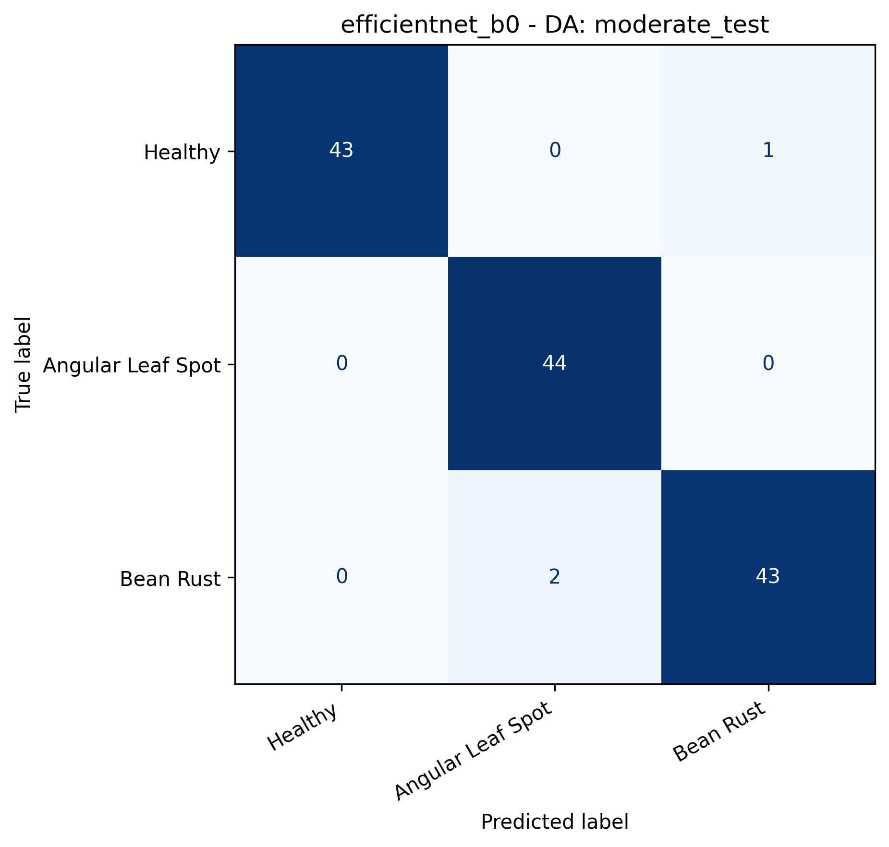
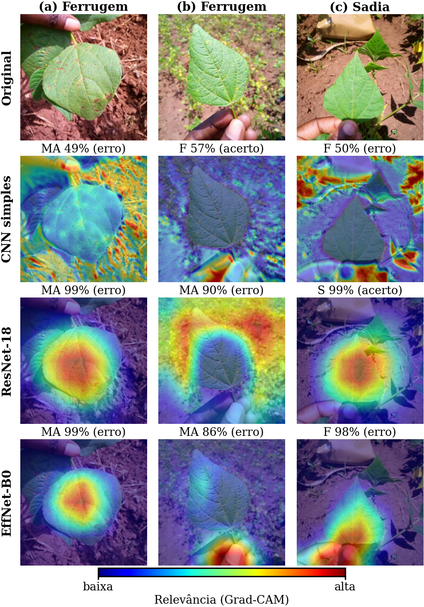

# Classificação de Doenças Foliares do Feijoeiro com CNNs

Análise comparativa de arquiteturas de redes neurais convolucionais para classificar folhas de feijoeiro como **saudável**, com **mancha angular** ou com **ferrugem**.

Trabalho da disciplina SIN 393, do curso de Sistemas de Informação da Universidade Federal de Viçosa (UFV), Campus Rio Paranaíba.

**Autores:** Ana Clara Lima Moreira - 9856, Nayara Costa Santos - 9876 e Rayson Teodoro do Carmo - 9901

## Artigo

Este repositório contém o código e os resultados do artigo:

> A. C. L. Moreira, N. C. Santos e R. T. do Carmo, "[Classificação de Doenças Foliares do Feijoeiro por meio de uma Análise Comparativa de Arquiteturas de Redes Neurais Convolucionais](artigo.pdf)," Universidade Federal de Viçosa, Rio Paranaíba, 2026.

A fundamentação, a revisão bibliográfica e a discussão completa dos resultados estão no [PDF do artigo](artigo.pdf).

## Vídeo de apresentação

<!-- Substitua a linha abaixo por: [Assista à apresentação no YouTube](URL_DO_VIDEO) -->
> **Link do YouTube:** https://youtu.be/VQwIXClMVKU

## Sumário

- [Artigo](#artigo)
- [Descrição do projeto](#descrição-do-projeto)
- [Base de dados](#base-de-dados)
- [Metodologia](#metodologia)
- [Resultados](#resultados)
- [Estrutura do repositório](#estrutura-do-repositório)
- [Requisitos e dependências](#requisitos-e-dependências)
- [Instruções de execução](#instruções-de-execução)
- [Limitações](#limitações)
- [Referências](#referências)

## Descrição do projeto

As doenças foliares reduzem a produção agrícola, e sua identificação por inspeção visual é demorada, cara e sujeita a erros. Este projeto usa visão computacional e aprendizado profundo para automatizar essa identificação no feijoeiro.

O objetivo é responder a duas perguntas:

1. Qual arquitetura classifica melhor as doenças: uma CNN simples, a ResNet-18 ou a EfficientNet-B0?
2. Qual é o efeito do aumento de dados (*data augmentation*, DA) em cada uma delas?

Foram realizados seis experimentos (três arquiteturas × duas condições de DA), avaliados por acurácia, precisão, recall, F1-score, matrizes de confusão e mapas Grad-CAM, que mostram as regiões da imagem mais relevantes para cada predição.

O melhor resultado foi o da **EfficientNet-B0 com DA moderado**, com **97,74% de acurácia** e **0,9775 de F1-score macro** no teste.

## Base de dados

[Bean Leaf Lesions Classification](https://www.kaggle.com/datasets/marquis03/bean-leaf-lesions-classification), do Kaggle, com 1.167 imagens RGB de 500×500 pixels capturadas em campo com smartphones.

| ID | Classe | Descrição | Treino | Validação | Teste | Total |
|:-:|---|---|--:|--:|--:|--:|
| 0 | `healthy` | Folha sem sintomas visíveis | 297 | 44 | 44 | 385 |
| 1 | `angular_leaf_spot` | Mancha angular (*Pseudocercospora griseola*) | 301 | 44 | 44 | 389 |
| 2 | `bean_rust` | Ferrugem (*Uromyces appendiculatus*) | 303 | 45 | 45 | 393 |
| | **Total** | | **901** | **133** | **133** | **1.167** |

A base original não tem conjunto de teste. Por isso, 133 imagens foram separadas do treino de forma estratificada, com semente 42. A validação original foi mantida. O dataset não está no repositório: o notebook faz o download automaticamente.

## Metodologia

### Pré-processamento e aumento de dados

Todas as imagens são redimensionadas para 224×224 e normalizadas com a média e o desvio padrão do ImageNet. O DA moderado é aplicado somente ao treino:

- espelhamento horizontal e vertical, cada um com probabilidade de 50%;
- rotação aleatória de até 20°, com preenchimento prévio por reflexão e recorte central;
- variação de brilho de até 15%, com probabilidade de 50%.

### Arquiteturas

| Modelo | Descrição | Pesos iniciais | Parâmetros |
|---|---|---|--:|
| CNN simples | Baseada na LeNet-5: 2 camadas convolucionais, pooling adaptativo e 3 camadas densas | Aleatórios | 61.411 |
| ResNet-18 | Rede residual com 18 camadas | ImageNet | 11.178.051 |
| EfficientNet-B0 | Rede com escalonamento composto | ImageNet | 4.011.391 |

Nas redes pré-treinadas, a camada de saída foi trocada por uma de três classes e todas as camadas foram reajustadas (*fine-tuning*).

### Configuração de treinamento

| Parâmetro | Valor |
|---|---|
| Função de perda | Entropia cruzada |
| Otimizador | Adam |
| Taxa de aprendizado inicial | 0,0001 |
| *Weight decay* | 0,0001 |
| Tamanho do lote | 16 |
| Máximo de épocas | 60 |
| *Scheduler* | ReduceLROnPlateau (fator 0,5 e paciência 5) |
| Parada antecipada | 21 épocas sem melhora |
| Seleção da época | Menor perda de validação |
| Semente | 42 |

## Resultados

Precisão, recall e F1-score são médias macro. A coluna "Época" indica a época de menor perda de validação.

### Teste

| Modelo | DA | Época | Acurácia | Precisão | Recall | F1-score |
|---|---|--:|--:|--:|--:|--:|
| CNN simples | Sem DA | 41 | 0,7744 | 0,7749 | 0,7753 | 0,7743 |
| CNN simples | Moderado | 56 | 0,7444 | 0,7432 | 0,7453 | 0,7417 |
| ResNet-18 | Sem DA | 47 | 0,9474 | 0,9515 | 0,9481 | 0,9466 |
| ResNet-18 | Moderado | 28 | 0,9549 | 0,9561 | 0,9554 | 0,9547 |
| EfficientNet-B0 | Sem DA | 20 | 0,9398 | 0,9425 | 0,9404 | 0,9395 |
| **EfficientNet-B0** | **Moderado** | **21** | **0,9774** | **0,9779** | **0,9776** | **0,9775** |

<details>
<summary>Resultados de validação</summary>

| Modelo | DA | Acurácia | Precisão | Recall | F1-score |
|---|---|--:|--:|--:|--:|
| CNN simples | Sem DA | 0,7594 | 0,7583 | 0,7598 | 0,7588 |
| CNN simples | Moderado | 0,7444 | 0,7425 | 0,7443 | 0,7394 |
| ResNet-18 | Sem DA | 0,9850 | 0,9852 | 0,9848 | 0,9849 |
| ResNet-18 | Moderado | 0,9699 | 0,9700 | 0,9700 | 0,9700 |
| EfficientNet-B0 | Sem DA | 0,9774 | 0,9778 | 0,9774 | 0,9775 |
| EfficientNet-B0 | Moderado | 1,0000 | 1,0000 | 1,0000 | 1,0000 |

</details>

### Matrizes de confusão no teste

| Modelo | Sem DA | DA moderado |
|---|:-:|:-:|
| CNN simples |  |  |
| ResNet-18 |  |  |
| EfficientNet-B0 |  |  |

As matrizes de validação estão em [`resultados/matrizes_confusao/validacao`](resultados/matrizes_confusao/validacao).

### Grad-CAM

A figura mostra as três imagens de teste que a EfficientNet-B0 com DA errou. Foram usadas a ResNet-18 e a EfficientNet-B0 com DA e a CNN simples sem DA (S: sadia, MA: mancha angular, F: ferrugem).



### Principais conclusões

- As redes pré-treinadas superaram a CNN simples com ampla margem.
- O DA melhorou a EfficientNet-B0 (+3,76 pontos percentuais de acurácia) e a ResNet-18 (+0,75), mas piorou a CNN simples (−3,01).
- A ferrugem foi a classe mais difícil, confundida principalmente com a mancha angular na maioria dos experimentos.
- Em alguns casos, os modelos deram relevância ao fundo da imagem ou à mão que segura a folha.

### Organização do notebook

| Parte | Seções | Conteúdo |
|---|---|---|
| Preparação | 1 | Dependências, parâmetros e pastas de saída |
| Dataset | 2 | Download, análise, divisão e pré-processamento |
| Experimento | 3 a 5 | Modelos, treinamento com validação e teste |
| Resultados | 6 e 7 | Gráficos, matrizes de confusão, resumo e Grad-CAM |

A seção 6 apenas lê os arquivos salvos no treino e no teste, por isso os gráficos podem ser refeitos sem treinar novamente.

## Requisitos e dependências

**Google Colab (recomendado, ambiente original do projeto):**

- conta Google, com cerca de 200 MB livres no Drive para pesos e resultados;
- ambiente de execução com GPU (os experimentos usaram uma NVIDIA Tesla T4);
- conexão com a internet.

**Execução local:**

- Python 3.12 ou 3.13;
- conexão com a internet e cerca de 5 GB livres;
- GPU NVIDIA com CUDA recomendada. Em CPU também funciona, mas o treino é bem mais lento.

| Biblioteca | Uso |
|---|---|
| PyTorch e torchvision | Modelos, treinamento e transformações |
| scikit-learn | Divisão dos dados e métricas |
| NumPy e pandas | Manipulação de dados |
| Matplotlib | Gráficos |
| Pillow | Leitura das imagens |
| KaggleHub | Download do dataset |
| grad-cam | Mapas Grad-CAM |
| JupyterLab e ipykernel | Execução local do notebook |

As versões para execução local estão em [`requirements.txt`](requirements.txt).

## Instruções de execução

### Opção 1: Google Colab

1. Baixe o arquivo [`Bean_Leaf_Classification.ipynb`](Bean_Leaf_Classification.ipynb).
2. Acesse o [Google Colab](https://colab.research.google.com/), vá em **Arquivo > Fazer upload de notebook** e envie o arquivo.
3. Em **Ambiente de execução > Alterar o tipo de ambiente de execução**, selecione uma GPU.
4. Clique em **Ambiente de execução > Executar tudo**. O Colab já traz as bibliotecas principais, e o notebook instala `kagglehub` e `grad-cam`.
5. Autorize o acesso ao Google Drive quando solicitado.
6. Ao final, consulte os resultados em `MyDrive/SIN393_Bean_Leaf_Classification/`.

### Opção 2: execução local

**1. Baixe o repositório** em **Code > Download ZIP** e extraia, ou clone com `git clone` e a URL exibida em **Code**. Depois abra um terminal na pasta do projeto.

**2. Crie e ative um ambiente virtual.**

Windows (PowerShell):

```powershell
python -m venv .venv
.venv\Scripts\Activate.ps1
```

Linux ou macOS:

```bash
python3 -m venv .venv
source .venv/bin/activate
```

**3. Instale as dependências.** Para usar GPU no Windows, instale antes o PyTorch com CUDA, seguindo o [guia oficial](https://pytorch.org/get-started/locally/).

```bash
pip install -r requirements.txt
```

**4. Abra o notebook.**

```bash
jupyter lab Bean_Leaf_Classification.ipynb
```

**5. Adapte as duas células que dependem do Google Drive** (seção 1.6 do notebook).

- Apague a célula `CONEXÃO COM O GOOGLE DRIVE`, que contém `drive.mount(...)`.
- Na célula `Diretórios`, troque `"/content/drive/MyDrive"` por `"."`.

**6. Execute tudo** em **Run > Run All Cells**. Os resultados ficam em `SIN393_Bean_Leaf_Classification/`.

### Arquivos gerados

| Local | Conteúdo |
|---|---|
| `checkpoints/` | Pesos do melhor modelo de cada experimento |
| `history/` | Histórico por época e curvas de perda e acurácia |
| `metrics/` | Métricas, matrizes de confusão e figura do Grad-CAM |
| `summary_val_test.csv` | Resumo de validação e teste |
| `*_completed.txt` | Marcadores de experimentos concluídos |

### Observações

- Execute as células em ordem, pois cada uma depende das anteriores.
- Experimentos concluídos não são treinados de novo. Para refazer do zero, apague a pasta `SIN393_Bean_Leaf_Classification/`.
- Os resultados podem variar entre execuções, mesmo com semente fixa, por diferenças de hardware, de versões e por operações não determinísticas na GPU.

## Limitações

O estudo usa uma base pequena e uma única divisão dos dados. Como trabalhos futuros, sugere-se avaliar outros conjuntos de imagens, testar outras estratégias de DA e analisar a generalização em condições de captura diferentes.

## Referências

Principais referências do projeto. A lista completa está no [artigo](artigo.pdf).

- Marquis03. [*Bean Leaf Lesions Classification*](https://www.kaggle.com/datasets/marquis03/bean-leaf-lesions-classification). Kaggle, 2023.
- Y. LeCun et al. *Gradient-based learning applied to document recognition*. Proceedings of the IEEE, 1998.
- K. He et al. [*Deep Residual Learning for Image Recognition*](https://arxiv.org/abs/1512.03385). CVPR, 2016.
- M. Tan e Q. V. Le. [*EfficientNet: Rethinking Model Scaling for Convolutional Neural Networks*](https://arxiv.org/abs/1905.11946). ICML, 2019.
- R. R. Selvaraju et al. [*Grad-CAM: Visual Explanations from Deep Networks via Gradient-Based Localization*](https://arxiv.org/abs/1610.02391). ICCV, 2017.
- J. Gildenblat et al. [*pytorch-grad-cam*](https://github.com/jacobgil/pytorch-grad-cam). GitHub, 2021.
